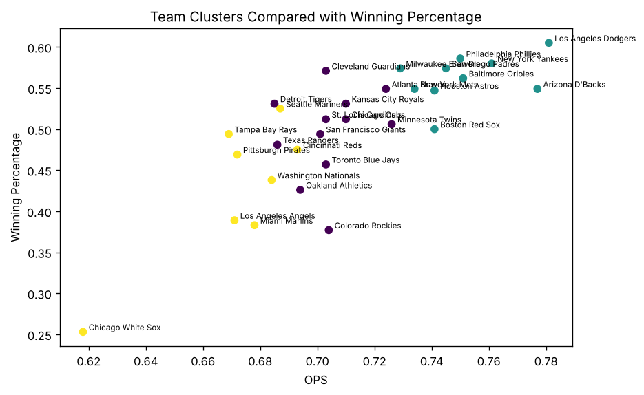
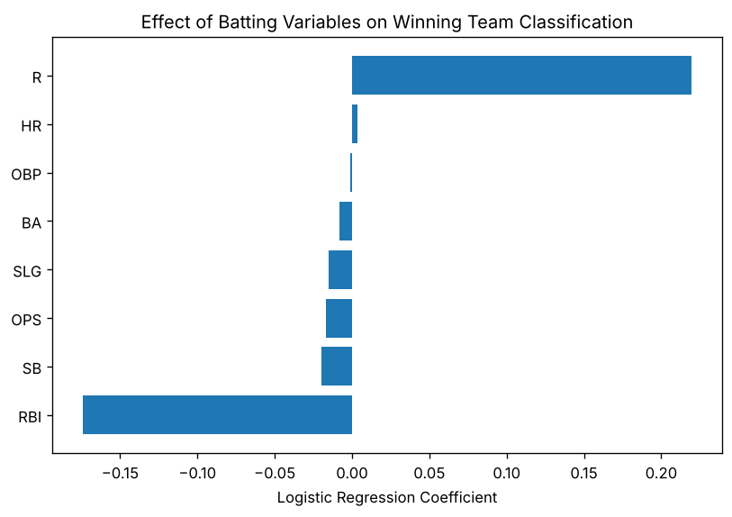

# Predicting MLB Team Success (2024)

Which offensive stats separate winning MLB teams from losing ones, and do teams fall into distinct offensive "types"? This project uses **logistic regression** and **K-means clustering** in Python (pandas, scikit-learn) on 2024 team batting and standings data.

**[Read the full analysis](report.md)** · Code: [`analysis.qmd`](analysis.qmd)



## Questions

1. Which batting statistics are most associated with a winning (> .500) record?
2. Can teams be grouped into meaningful offensive profiles?
3. Did some offensive profiles win more than others?

## Approach

- **Data pipeline:** loaded team batting stats and standings, dropped league-average rows, standardized team names so the two sources merge cleanly, and created a binary `winning_team` target.
- **EDA:** scatterplots and a correlation matrix. Runs scored (r = 0.81) and OPS (r = 0.79) are both strongly correlated with win percentage.
- **Logistic regression** on runs, home runs, BA, RBI, stolen bases, OBP, SLG and OPS to classify winning teams, interpreted through coefficients and odds ratios.
- **K-means clustering** on standardized batting stats, with *k* = 3 chosen from an elbow plot. The clusters are then profiled and compared against actual records.

## Key findings

- The model correctly classifies **25 of 30 teams (83% training accuracy)** using batting stats alone.
- **Runs scored is the dominant predictor** (odds ratio ≈ 1.25 per run). RBI gets a negative coefficient because it overlaps heavily with runs (multicollinearity), so the model leans on runs.
- The clustering finds three offensive profiles:

| Cluster | Teams | Avg runs | Avg HR | Avg OPS | Avg win % | Winning teams |
|---|---|---|---|---|---|---|
| High-powered offense | 10 | 791 | 207 | .751 | .563 | 9 of 10 |
| Middle of the pack | 12 | 696 | 178 | .704 | .496 | 7 of 12 |
| Low-production / speed | 8 | 635 | 156 | .672 | .428 | 1 of 8 |

- The high-powered cluster includes the Dodgers, Yankees, Phillies, Orioles and Padres. The low-production cluster had the most stolen bases but the worst records, so speed alone didn't translate into wins in 2024.

**Limitations:** 30 teams is a small sample, accuracy is measured in-sample, and the model uses only offense (no pitching or defense).



## Tools

Python · pandas · NumPy · scikit-learn · Matplotlib · Quarto

## Reproduce

```bash
pip install pandas numpy scikit-learn matplotlib jupyter
quarto render analysis.qmd          # HTML report
quarto render analysis.qmd --to gfm -o report.md   # GitHub-readable version
```

## Data

- `data/mlb-team-batting-2024.csv`: 2024 team batting from the [SCORE Sports Data Repository](https://data.scorenetwork.org/baseball/mlb-team-batting-2024.html) (Baseball-Reference)
- `data/mlb-standings-2024.csv`: 2024 wins, losses and league from the [Lahman Baseball Database](https://www.seanlahman.com/baseball-archive/statistics/) `Teams` table

Final project for an Introduction to Data Science course at the University of Connecticut (Spring 2026).
