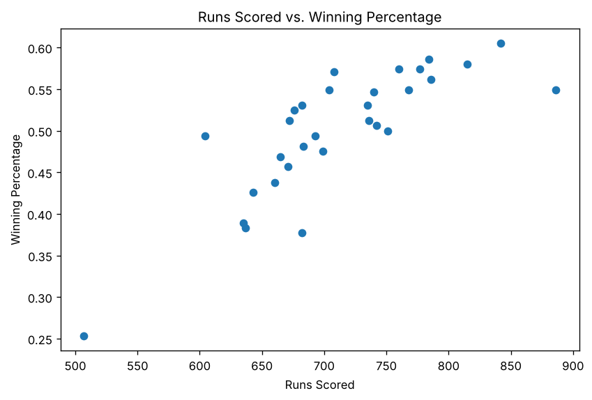
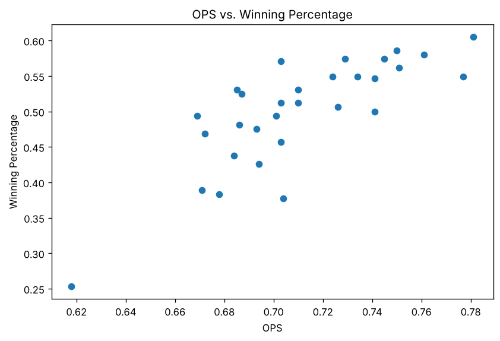
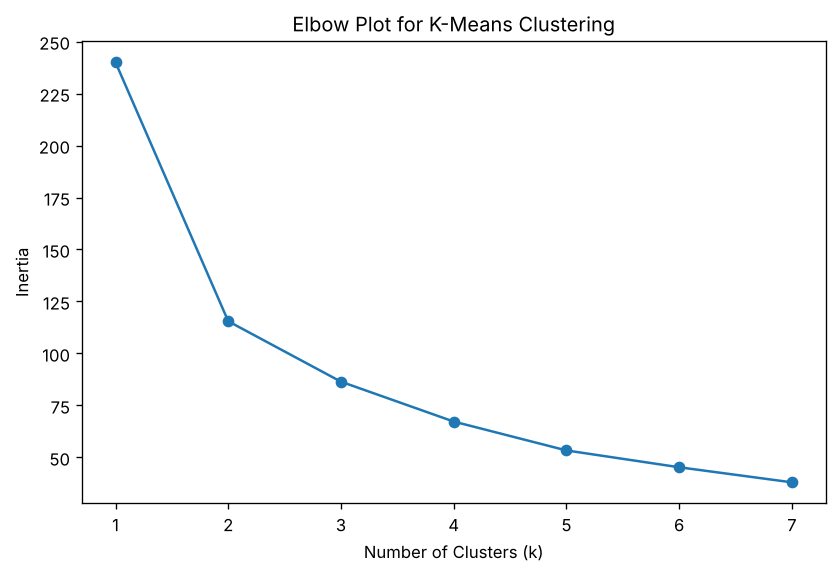
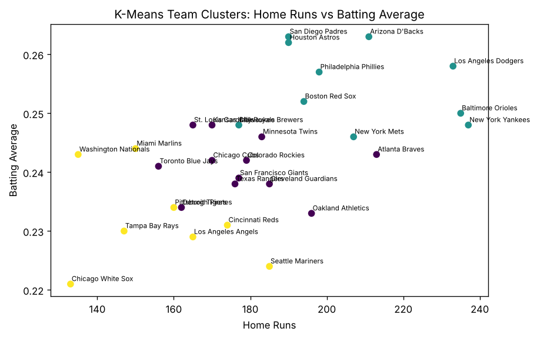

# Predicting MLB Team Success with Logistic Regression and K-Means Clustering
Sean Tessman

## Introduction

Baseball is one of the most data-driven sports, and team statistics can
tell us a lot about why some teams are more successful than others. In
this project, I use two different data science methods to study Major
League Baseball team performance during the 2024 season. First, I use
logistic regression to examine which team batting statistics are most
related to finishing the season with a winning record. Then, I use
K-means clustering to group teams into different offensive profiles
based on their batting statistics.

This project uses team-level batting data from the SCORE Sports Data
Repository, which is based on Baseball-Reference data from the 2024 MLB
season. The batting dataset includes the 30 MLB teams plus a
league-average row. The standings data (wins, losses, win percentage and
league for each team) comes from the 2024 `Teams` table in the Lahman
Baseball Database. These datasets make it possible to study both
offensive production and team success in the same analysis.

The main research questions in this project are:

1.  Which batting statistics are most associated with a team having a
    winning record?
2.  Can MLB teams be grouped into meaningful offensive profiles using
    clustering?
3.  What do the regression and clustering results suggest about team
    success in 2024?

## Data and Variables

The main batting dataset includes team offensive statistics such as
runs, hits, home runs, RBIs, stolen bases, walks, strikeouts, batting
average, on-base percentage, slugging percentage, and OPS. The standings
dataset includes team win percentage and league. These two files are
merged by team name so the batting data can be linked to team success.

For this project, the main variables used are:

- `R` = runs scored
- `HR` = home runs
- `BA` = batting average
- `RBI` = runs batted in
- `SB` = stolen bases
- `OBP` = on-base percentage
- `SLG` = slugging percentage
- `OPS` = on-base plus slugging
- `Win%` = team winning percentage
- `winning_team` = binary outcome variable where 1 means above .500 and
  0 means .500 or below

``` python
import pandas as pd
import numpy as np
import matplotlib.pyplot as plt

from sklearn.linear_model import LogisticRegression
from sklearn.preprocessing import StandardScaler
from sklearn.cluster import KMeans
from sklearn.metrics import accuracy_score, confusion_matrix

plt.rcParams["figure.figsize"] = (8, 5)
plt.rcParams["figure.dpi"] = 120
```

This chunk imports the libraries used in the project. Pandas is used for
data wrangling, matplotlib is used for graphs, and scikit-learn is used
for logistic regression, scaling, and clustering.

## Load the Data

``` python
batting = pd.read_csv("data/mlb-team-batting-2024.csv")
standings = pd.read_csv("data/mlb-standings-2024.csv")

print("Batting data shape:", batting.shape)
print("Standings data shape:", standings.shape)

batting.head()
```

    Batting data shape: (32, 29)
    Standings data shape: (30, 5)

<div>
<style scoped>
    .dataframe tbody tr th:only-of-type {
        vertical-align: middle;
    }
&#10;    .dataframe tbody tr th {
        vertical-align: top;
    }
&#10;    .dataframe thead th {
        text-align: right;
    }
</style>

|  | Tm | \#Bat | BatAge | R/G | G | PA | AB | R | H | 2B | ... | SLG | OPS | OPS+ | TB | GDP | HBP | SH | SF | IBB | LOB |
|----|----|----|----|----|----|----|----|----|----|----|----|----|----|----|----|----|----|----|----|----|----|
| 0 | Arizona Diamondbacks | 51 | 28.6 | 5.47 | 162 | 6284 | 5522 | 886 | 1452 | 271 | ... | 0.440 | 0.777 | 115 | 2430 | 112 | 84 | 34 | 66 | 17 | 1111 |
| 1 | Atlanta Braves | 55 | 29.3 | 4.35 | 162 | 6075 | 5481 | 704 | 1333 | 273 | ... | 0.415 | 0.724 | 100 | 2275 | 119 | 58 | 9 | 39 | 11 | 1088 |
| 2 | Baltimore Orioles | 60 | 26.9 | 4.85 | 162 | 6176 | 5567 | 786 | 1391 | 262 | ... | 0.435 | 0.751 | 116 | 2424 | 71 | 64 | 6 | 45 | 14 | 1108 |
| 3 | Boston Red Sox | 57 | 27.3 | 4.64 | 162 | 6192 | 5577 | 751 | 1404 | 311 | ... | 0.423 | 0.741 | 106 | 2357 | 110 | 73 | 7 | 40 | 30 | 1116 |
| 4 | Chicago Cubs | 56 | 27.8 | 4.54 | 162 | 6116 | 5441 | 736 | 1318 | 253 | ... | 0.393 | 0.710 | 100 | 2139 | 89 | 70 | 17 | 41 | 19 | 1105 |

<p>5 rows × 29 columns</p>
</div>

This chunk loads the two datasets. The batting data contains team
batting statistics, and the standings data contains team win percentage.
The output should show the number of rows and columns and preview the
first few rows of the batting dataset.

``` python
standings.head()
```

<div>
<style scoped>
    .dataframe tbody tr th:only-of-type {
        vertical-align: middle;
    }
&#10;    .dataframe tbody tr th {
        vertical-align: top;
    }
&#10;    .dataframe thead th {
        text-align: right;
    }
</style>

|     | Team                  | Win%  | League | W   | L   |
|-----|-----------------------|-------|--------|-----|-----|
| 0   | Los Angeles Dodgers   | 0.605 | NL     | 98  | 64  |
| 1   | Philadelphia Phillies | 0.586 | NL     | 95  | 67  |
| 2   | New York Yankees      | 0.580 | AL     | 94  | 68  |
| 3   | Milwaukee Brewers     | 0.574 | NL     | 93  | 69  |
| 4   | San Diego Padres      | 0.574 | NL     | 93  | 69  |

</div>

This chunk previews the standings dataset so we can confirm the
team-level success variables are available before merging.

## Data Preparation

``` python
batting.columns.tolist()
```

    ['Tm',
     '#Bat',
     'BatAge',
     'R/G',
     'G',
     'PA',
     'AB',
     'R',
     'H',
     '2B',
     '3B',
     'HR',
     'RBI',
     'SB',
     'CS',
     'BB',
     'SO',
     'BA',
     'OBP',
     'SLG',
     'OPS',
     'OPS+',
     'TB',
     'GDP',
     'HBP',
     'SH',
     'SF',
     'IBB',
     'LOB']

This chunk shows all of the batting dataset column names. This is useful
because it confirms which variables are available for analysis and helps
avoid selecting columns that do not exist.

``` python
# Remove the total and league-average rows
batting = batting[~batting["Tm"].isin(["LgAvg per 600 PA", "MLB Total", "League Average"])].copy()
batting = batting.dropna(subset=["Tm"])

# Keep only the columns needed for this project
batting = batting[["Tm", "R", "HR", "BA", "RBI", "SB", "OBP", "SLG", "OPS", "BB", "SO"]].copy()

# Rename standings team column if needed and keep only useful columns
standings = standings.rename(columns={"Team": "Tm"})
standings = standings[["Tm", "Win%", "League"]].copy()

# Clean team names to improve merge reliability
def clean_team_name(name):
    name = str(name).strip()
    name = name.replace("Arizona Diamondbacks", "Arizona D'Backs")
    return name

batting["Tm"] = batting["Tm"].apply(clean_team_name)
standings["Tm"] = standings["Tm"].apply(clean_team_name)

# Merge batting and standings data
mlb = batting.merge(standings, on="Tm", how="inner")

# Create binary outcome: 1 = winning record, 0 = not winning
mlb["winning_team"] = (mlb["Win%"] > 0.500).astype(int)

print("Merged dataset shape:", mlb.shape)
mlb.head()
```

    Merged dataset shape: (30, 14)

<div>
<style scoped>
    .dataframe tbody tr th:only-of-type {
        vertical-align: middle;
    }
&#10;    .dataframe tbody tr th {
        vertical-align: top;
    }
&#10;    .dataframe thead th {
        text-align: right;
    }
</style>

|  | Tm | R | HR | BA | RBI | SB | OBP | SLG | OPS | BB | SO | Win% | League | winning_team |
|----|----|----|----|----|----|----|----|----|----|----|----|----|----|----|
| 0 | Arizona D'Backs | 886 | 211 | 0.263 | 845 | 119 | 0.337 | 0.440 | 0.777 | 569 | 1265 | 0.549 | NL | 1 |
| 1 | Atlanta Braves | 704 | 213 | 0.243 | 674 | 69 | 0.309 | 0.415 | 0.724 | 485 | 1461 | 0.549 | NL | 1 |
| 2 | Baltimore Orioles | 786 | 235 | 0.250 | 759 | 98 | 0.315 | 0.435 | 0.751 | 489 | 1359 | 0.562 | AL | 1 |
| 3 | Boston Red Sox | 751 | 194 | 0.252 | 724 | 144 | 0.319 | 0.423 | 0.741 | 493 | 1570 | 0.500 | AL | 0 |
| 4 | Chicago Cubs | 736 | 170 | 0.242 | 696 | 143 | 0.317 | 0.393 | 0.710 | 546 | 1362 | 0.512 | NL | 1 |

</div>

This chunk prepares the final analysis dataset. It removes the non-team
rows from the batting data, keeps the most useful variables, merges the
batting data with the standings data, and creates a binary variable
called `winning_team`. In the final output, each row should represent
one MLB team.

``` python
mlb.info()
```

    <class 'pandas.DataFrame'>
    RangeIndex: 30 entries, 0 to 29
    Data columns (total 14 columns):
     #   Column        Non-Null Count  Dtype  
    ---  ------        --------------  -----  
     0   Tm            30 non-null     str    
     1   R             30 non-null     int64  
     2   HR            30 non-null     int64  
     3   BA            30 non-null     float64
     4   RBI           30 non-null     int64  
     5   SB            30 non-null     int64  
     6   OBP           30 non-null     float64
     7   SLG           30 non-null     float64
     8   OPS           30 non-null     float64
     9   BB            30 non-null     int64  
     10  SO            30 non-null     int64  
     11  Win%          30 non-null     float64
     12  League        30 non-null     str    
     13  winning_team  30 non-null     int64  
    dtypes: float64(5), int64(7), str(2)
    memory usage: 3.4 KB

This chunk checks the structure of the merged dataset. The output
confirms the variable types and shows whether there are any missing
values that would cause problems later in the analysis.

## Summary Statistics

``` python
summary_stats = mlb[["R", "HR", "BA", "RBI", "SB", "OBP", "SLG", "OPS", "Win%"]].describe().T
summary_stats
```

<div>
<style scoped>
    .dataframe tbody tr th:only-of-type {
        vertical-align: middle;
    }
&#10;    .dataframe tbody tr th {
        vertical-align: top;
    }
&#10;    .dataframe thead th {
        text-align: right;
    }
</style>

|      | count | mean       | std       | min     | 25%       | 50%      | 75%       | max     |
|------|-------|------------|-----------|---------|-----------|----------|-----------|---------|
| R    | 30.0  | 711.433333 | 75.465308 | 507.000 | 671.25000 | 701.5000 | 757.75000 | 886.000 |
| HR   | 30.0  | 181.766667 | 26.940142 | 133.000 | 165.00000 | 178.0000 | 195.50000 | 237.000 |
| BA   | 30.0  | 0.243167   | 0.011014  | 0.221   | 0.23500   | 0.2430   | 0.24800   | 0.263   |
| RBI  | 30.0  | 679.300000 | 74.140663 | 485.000 | 640.50000 | 666.5000 | 725.50000 | 845.000 |
| SB   | 30.0  | 120.566667 | 43.087468 | 65.000  | 90.25000  | 112.5000 | 142.25000 | 223.000 |
| OBP  | 30.0  | 0.311867   | 0.012517  | 0.278   | 0.30425   | 0.3100   | 0.31900   | 0.337   |
| SLG  | 30.0  | 0.398967   | 0.024602  | 0.340   | 0.38125   | 0.3955   | 0.41725   | 0.446   |
| OPS  | 30.0  | 0.711033   | 0.035847  | 0.618   | 0.68625   | 0.7035   | 0.73925   | 0.781   |
| Win% | 30.0  | 0.499967   | 0.077075  | 0.253   | 0.47050   | 0.5120   | 0.54900   | 0.605   |

</div>

This chunk creates summary statistics for the main numerical variables.
The output helps show the center and spread of the data, including
averages, minimums, maximums, and quartiles.

## Exploratory Data Analysis

### Relationship Between Runs and Winning Percentage

``` python
plt.scatter(mlb["R"], mlb["Win%"])
plt.xlabel("Runs Scored")
plt.ylabel("Winning Percentage")
plt.title("Runs Scored vs. Winning Percentage")
plt.show()
```



This graph shows the relationship between total runs scored and winning
percentage. If the points trend upward, that suggests teams that score
more runs usually have better records.

### Relationship Between OPS and Winning Percentage

``` python
plt.scatter(mlb["OPS"], mlb["Win%"])
plt.xlabel("OPS")
plt.ylabel("Winning Percentage")
plt.title("OPS vs. Winning Percentage")
plt.show()
```



This graph shows whether stronger overall hitting, measured by OPS, is
associated with winning percentage. An upward pattern would suggest that
better offensive teams tend to win more games.

### Correlation Matrix

``` python
corr = mlb[["R", "HR", "BA", "RBI", "SB", "OBP", "SLG", "OPS", "Win%"]].corr()
corr.round(3)
```

<div>
<style scoped>
    .dataframe tbody tr th:only-of-type {
        vertical-align: middle;
    }
&#10;    .dataframe tbody tr th {
        vertical-align: top;
    }
&#10;    .dataframe thead th {
        text-align: right;
    }
</style>

|      | R     | HR     | BA     | RBI   | SB     | OBP   | SLG    | OPS    | Win%  |
|------|-------|--------|--------|-------|--------|-------|--------|--------|-------|
| R    | 1.000 | 0.789  | 0.800  | 0.997 | 0.052  | 0.929 | 0.926  | 0.958  | 0.810 |
| HR   | 0.789 | 1.000  | 0.542  | 0.803 | -0.230 | 0.703 | 0.872  | 0.841  | 0.672 |
| BA   | 0.800 | 0.542  | 1.000  | 0.799 | -0.033 | 0.812 | 0.848  | 0.865  | 0.617 |
| RBI  | 0.997 | 0.803  | 0.799  | 1.000 | 0.024  | 0.914 | 0.934  | 0.957  | 0.800 |
| SB   | 0.052 | -0.230 | -0.033 | 0.024 | 1.000  | 0.127 | -0.127 | -0.042 | 0.100 |
| OBP  | 0.929 | 0.703  | 0.812  | 0.914 | 0.127  | 1.000 | 0.860  | 0.936  | 0.789 |
| SLG  | 0.926 | 0.872  | 0.848  | 0.934 | -0.127 | 0.860 | 1.000  | 0.984  | 0.749 |
| OPS  | 0.958 | 0.841  | 0.865  | 0.957 | -0.042 | 0.936 | 0.984  | 1.000  | 0.790 |
| Win% | 0.810 | 0.672  | 0.617  | 0.800 | 0.100  | 0.789 | 0.749  | 0.790  | 1.000 |

</div>

This chunk computes the correlation matrix for the main team batting
variables and winning percentage. The values show which variables tend
to move together and which variables appear most related to team
success.

## Logistic Regression

The goal of the logistic regression is to predict whether a team
finished above .500 based on its batting statistics. Since the response
variable is binary, logistic regression is the right method for this
part of the project.

``` python
X = mlb[["R", "HR", "BA", "RBI", "SB", "OBP", "SLG", "OPS"]].copy()
y = mlb["winning_team"]

log_model = LogisticRegression(max_iter=2000)
log_model.fit(X, y)

predictions = log_model.predict(X)
probabilities = log_model.predict_proba(X)[:, 1]

mlb["predicted_win_class"] = predictions
mlb["predicted_win_probability"] = probabilities

print("Training accuracy:", round(accuracy_score(y, predictions), 3))
print("Confusion matrix:")
print(confusion_matrix(y, predictions))
```

    Training accuracy: 0.833
    Confusion matrix:
    [[11  2]
     [ 3 14]]

This chunk fits the logistic regression model and uses the batting
variables to predict whether a team had a winning record. The output
includes the model accuracy and the confusion matrix, which shows how
many teams were classified correctly.

``` python
coef_table = pd.DataFrame({
    "Variable": X.columns,
    "Coefficient": log_model.coef_[0],
    "Odds_Ratio": np.exp(log_model.coef_[0])
}).sort_values("Coefficient", ascending=False)

coef_table
```

<div>
<style scoped>
    .dataframe tbody tr th:only-of-type {
        vertical-align: middle;
    }
&#10;    .dataframe tbody tr th {
        vertical-align: top;
    }
&#10;    .dataframe thead th {
        text-align: right;
    }
</style>

|     | Variable | Coefficient | Odds_Ratio |
|-----|----------|-------------|------------|
| 0   | R        | 0.219624    | 1.245608   |
| 1   | HR       | 0.003611    | 1.003618   |
| 5   | OBP      | -0.001304   | 0.998697   |
| 2   | BA       | -0.008005   | 0.992027   |
| 6   | SLG      | -0.015421   | 0.984698   |
| 7   | OPS      | -0.016717   | 0.983421   |
| 4   | SB       | -0.019582   | 0.980608   |
| 3   | RBI      | -0.174254   | 0.840083   |

</div>

This chunk creates a table of model coefficients and odds ratios.
Positive coefficients suggest that a higher value of that statistic
increases the probability of being a winning team, while negative
coefficients suggest the opposite.

``` python
coef_table_plot = coef_table.sort_values("Coefficient")

plt.barh(coef_table_plot["Variable"], coef_table_plot["Coefficient"])
plt.xlabel("Logistic Regression Coefficient")
plt.title("Effect of Batting Variables on Winning Team Classification")
plt.show()
```


This graph visualizes the logistic regression coefficients. Variables
farther to the right have a stronger positive relationship with
finishing above .500, while variables farther to the left have a more
negative relationship.

``` python
mlb[["Tm", "Win%", "winning_team", "predicted_win_probability"]].sort_values(
    "predicted_win_probability", ascending=False
)
```

<div>
<style scoped>
    .dataframe tbody tr th:only-of-type {
        vertical-align: middle;
    }
&#10;    .dataframe tbody tr th {
        vertical-align: top;
    }
&#10;    .dataframe thead th {
        text-align: right;
    }
</style>

|     | Tm                    | Win%  | winning_team | predicted_win_probability |
|-----|-----------------------|-------|--------------|---------------------------|
| 0   | Arizona D'Backs       | 0.549 | 1            | 0.999968                  |
| 18  | New York Yankees      | 0.580 | 1            | 0.998398                  |
| 13  | Los Angeles Dodgers   | 0.605 | 1            | 0.996527                  |
| 16  | Minnesota Twins       | 0.506 | 1            | 0.990039                  |
| 20  | Philadelphia Phillies | 0.586 | 1            | 0.979908                  |
| 2   | Baltimore Orioles     | 0.562 | 1            | 0.979583                  |
| 17  | New York Mets         | 0.549 | 1            | 0.979010                  |
| 10  | Houston Astros        | 0.547 | 1            | 0.978343                  |
| 22  | San Diego Padres      | 0.574 | 1            | 0.965035                  |
| 4   | Chicago Cubs          | 0.512 | 1            | 0.940084                  |
| 15  | Milwaukee Brewers     | 0.574 | 1            | 0.910321                  |
| 3   | Boston Red Sox        | 0.500 | 0            | 0.774570                  |
| 1   | Atlanta Braves        | 0.549 | 1            | 0.761783                  |
| 7   | Cleveland Guardians   | 0.571 | 1            | 0.748488                  |
| 24  | San Francisco Giants  | 0.494 | 0            | 0.711403                  |
| 11  | Kansas City Royals    | 0.531 | 1            | 0.523893                  |
| 27  | Texas Rangers         | 0.481 | 0            | 0.426355                  |
| 25  | St. Louis Cardinals   | 0.512 | 1            | 0.408521                  |
| 28  | Toronto Blue Jays     | 0.457 | 0            | 0.395488                  |
| 8   | Colorado Rockies      | 0.377 | 0            | 0.311323                  |
| 9   | Detroit Tigers        | 0.531 | 1            | 0.298860                  |
| 6   | Cincinnati Reds       | 0.475 | 0            | 0.297126                  |
| 23  | Seattle Mariners      | 0.525 | 1            | 0.288855                  |
| 12  | Los Angeles Angels    | 0.389 | 0            | 0.138879                  |
| 29  | Washington Nationals  | 0.438 | 0            | 0.071652                  |
| 21  | Pittsburgh Pirates    | 0.469 | 0            | 0.051403                  |
| 19  | Oakland Athletics     | 0.426 | 0            | 0.036301                  |
| 14  | Miami Marlins         | 0.383 | 0            | 0.019897                  |
| 26  | Tampa Bay Rays        | 0.494 | 0            | 0.017934                  |
| 5   | Chicago White Sox     | 0.253 | 0            | 0.000052                  |

</div>

This output shows each team’s actual winning percentage and the logistic
regression model’s predicted probability of being a winning team. Teams
with higher predicted probabilities are the teams the model views as
stronger offensively.

## K-Means Clustering

The second part of the project uses K-means clustering to group teams
into different offensive profiles. This is an unsupervised learning
method, so the algorithm forms groups based only on the batting
statistics and not on winning percentage.

``` python
cluster_vars = mlb[["R", "HR", "BA", "RBI", "SB", "OBP", "SLG", "OPS"]].copy()

scaler = StandardScaler()
cluster_scaled = scaler.fit_transform(cluster_vars)
```

This chunk selects the batting variables for clustering and scales them
so that variables measured on different scales can be compared fairly.

``` python
inertia_values = []

for k in range(1, 8):
    km = KMeans(n_clusters=k, random_state=42, n_init=20)
    km.fit(cluster_scaled)
    inertia_values.append(km.inertia_)

plt.plot(range(1, 8), inertia_values, marker="o")
plt.xlabel("Number of Clusters (k)")
plt.ylabel("Inertia")
plt.title("Elbow Plot for K-Means Clustering")
plt.show()
```



This elbow plot helps choose a reasonable number of clusters. We look
for where the drop in inertia starts to level off. For this project,
using 3 clusters gives a clear and interpretable grouping of teams.

``` python
kmeans = KMeans(n_clusters=3, random_state=42, n_init=20)
mlb["cluster"] = kmeans.fit_predict(cluster_scaled)

mlb[["Tm", "cluster"]].sort_values("cluster")
```

<div>
<style scoped>
    .dataframe tbody tr th:only-of-type {
        vertical-align: middle;
    }
&#10;    .dataframe tbody tr th {
        vertical-align: top;
    }
&#10;    .dataframe thead th {
        text-align: right;
    }
</style>

|     | Tm                    | cluster |
|-----|-----------------------|---------|
| 1   | Atlanta Braves        | 0       |
| 4   | Chicago Cubs          | 0       |
| 7   | Cleveland Guardians   | 0       |
| 8   | Colorado Rockies      | 0       |
| 9   | Detroit Tigers        | 0       |
| 11  | Kansas City Royals    | 0       |
| 19  | Oakland Athletics     | 0       |
| 16  | Minnesota Twins       | 0       |
| 24  | San Francisco Giants  | 0       |
| 25  | St. Louis Cardinals   | 0       |
| 27  | Texas Rangers         | 0       |
| 28  | Toronto Blue Jays     | 0       |
| 13  | Los Angeles Dodgers   | 1       |
| 15  | Milwaukee Brewers     | 1       |
| 3   | Boston Red Sox        | 1       |
| 0   | Arizona D'Backs       | 1       |
| 22  | San Diego Padres      | 1       |
| 20  | Philadelphia Phillies | 1       |
| 17  | New York Mets         | 1       |
| 18  | New York Yankees      | 1       |
| 10  | Houston Astros        | 1       |
| 2   | Baltimore Orioles     | 1       |
| 5   | Chicago White Sox     | 2       |
| 6   | Cincinnati Reds       | 2       |
| 14  | Miami Marlins         | 2       |
| 12  | Los Angeles Angels    | 2       |
| 23  | Seattle Mariners      | 2       |
| 21  | Pittsburgh Pirates    | 2       |
| 26  | Tampa Bay Rays        | 2       |
| 29  | Washington Nationals  | 2       |

</div>

This chunk fits the final K-means model with 3 clusters and assigns each
team to a group. The output shows which cluster each team belongs to.

``` python
cluster_summary = mlb.groupby("cluster")[["R", "HR", "BA", "RBI", "SB", "OBP", "SLG", "OPS", "Win%"]].mean().round(3)
cluster_summary
```

<div>
<style scoped>
    .dataframe tbody tr th:only-of-type {
        vertical-align: middle;
    }
&#10;    .dataframe tbody tr th {
        vertical-align: top;
    }
&#10;    .dataframe thead th {
        text-align: right;
    }
</style>

|         | R       | HR      | BA    | RBI     | SB     | OBP   | SLG   | OPS   | Win%  |
|---------|---------|---------|-------|---------|--------|-------|-------|-------|-------|
| cluster |         |         |       |         |        |       |       |       |       |
| 0       | 695.917 | 177.667 | 0.241 | 664.583 | 95.50  | 0.308 | 0.396 | 0.704 | 0.496 |
| 1       | 790.900 | 207.200 | 0.255 | 757.900 | 126.90 | 0.326 | 0.425 | 0.751 | 0.563 |
| 2       | 635.375 | 156.125 | 0.232 | 603.125 | 150.25 | 0.301 | 0.370 | 0.672 | 0.428 |

</div>

This table summarizes the average batting profile of each cluster. It
helps interpret the groups by showing whether a cluster is stronger in
power, batting average, speed, or overall offensive production.

``` python
plt.scatter(mlb["HR"], mlb["BA"], c=mlb["cluster"])
for _, row in mlb.iterrows():
    plt.text(row["HR"] + 0.3, row["BA"] + 0.0005, row["Tm"], fontsize=7)

plt.xlabel("Home Runs")
plt.ylabel("Batting Average")
plt.title("K-Means Team Clusters: Home Runs vs Batting Average")
plt.show()
```



This graph shows the team clusters using home runs and batting average.
Teams in the same color belong to the same cluster, which helps
visualize how the groups differ.

``` python
plt.scatter(mlb["OPS"], mlb["Win%"], c=mlb["cluster"])
for _, row in mlb.iterrows():
    plt.text(row["OPS"] + 0.002, row["Win%"] + 0.002, row["Tm"], fontsize=7)

plt.xlabel("OPS")
plt.ylabel("Winning Percentage")
plt.title("Team Clusters Compared with Winning Percentage")
plt.show()
```


This graph compares the team clusters to winning percentage. It helps
show whether one type of offensive team profile was more successful than
the others during the 2024 season.

## Main Findings

The logistic regression and clustering analyses can now be combined to
answer the main research questions.

``` python
cluster_win_summary = mlb.groupby("cluster")[["Win%", "winning_team"]].agg(["mean", "sum", "count"]).round(3)
cluster_win_summary
```

<div>
<style scoped>
    .dataframe tbody tr th:only-of-type {
        vertical-align: middle;
    }
&#10;    .dataframe tbody tr th {
        vertical-align: top;
    }
&#10;    .dataframe thead tr th {
        text-align: left;
    }
&#10;    .dataframe thead tr:last-of-type th {
        text-align: right;
    }
</style>

<table class="dataframe" data-quarto-postprocess="true" data-border="1">
<thead>
<tr>
<th data-quarto-table-cell-role="th"></th>
<th colspan="3" data-quarto-table-cell-role="th"
data-halign="left">Win%</th>
<th colspan="3" data-quarto-table-cell-role="th"
data-halign="left">winning_team</th>
</tr>
<tr>
<th data-quarto-table-cell-role="th"></th>
<th data-quarto-table-cell-role="th">mean</th>
<th data-quarto-table-cell-role="th">sum</th>
<th data-quarto-table-cell-role="th">count</th>
<th data-quarto-table-cell-role="th">mean</th>
<th data-quarto-table-cell-role="th">sum</th>
<th data-quarto-table-cell-role="th">count</th>
</tr>
<tr>
<th data-quarto-table-cell-role="th">cluster</th>
<th data-quarto-table-cell-role="th"></th>
<th data-quarto-table-cell-role="th"></th>
<th data-quarto-table-cell-role="th"></th>
<th data-quarto-table-cell-role="th"></th>
<th data-quarto-table-cell-role="th"></th>
<th data-quarto-table-cell-role="th"></th>
</tr>
</thead>
<tbody>
<tr>
<td data-quarto-table-cell-role="th">0</td>
<td>0.496</td>
<td>5.947</td>
<td>12</td>
<td>0.583</td>
<td>7</td>
<td>12</td>
</tr>
<tr>
<td data-quarto-table-cell-role="th">1</td>
<td>0.563</td>
<td>5.626</td>
<td>10</td>
<td>0.900</td>
<td>9</td>
<td>10</td>
</tr>
<tr>
<td data-quarto-table-cell-role="th">2</td>
<td>0.428</td>
<td>3.426</td>
<td>8</td>
<td>0.125</td>
<td>1</td>
<td>8</td>
</tr>
</tbody>
</table>

</div>

This output shows how each cluster performed overall in terms of winning
percentage and number of winning teams. It helps connect the
unsupervised clustering results back to team success.

## Discussion

The logistic regression results show which batting statistics were most
useful for separating winning teams from non-winning teams. In general,
offensive production variables such as runs scored, OPS, slugging
percentage, and RBIs should have the strongest positive relationships
with being a winning team. That makes sense because teams that create
more offense usually give themselves a better chance to win games.

The clustering results show that teams can also be grouped into
different offensive identities. Some teams will appear as more
power-focused, some as more balanced, and some as lower-production
teams. Looking at the average winning percentages within each cluster
helps show whether certain offensive profiles were more successful than
others during the 2024 season.

Because this project uses only batting data, the results should not be
interpreted as explaining everything about winning. Pitching, defense,
injuries, and strength of schedule also matter. Even so, this project
gives a clear example of how team batting statistics are connected to
team success.

## Conclusion

This project used logistic regression and K-means clustering to study
MLB team performance during the 2024 season. Logistic regression was
used to predict whether a team finished above .500 based on batting
statistics, while K-means clustering was used to group teams into
different offensive profiles.

Overall, the analysis shows that stronger offensive production is
closely related to team success. Teams that score more runs and produce
better overall hitting numbers are more likely to finish with winning
records. The clustering analysis also shows that MLB teams can be
grouped into meaningful offensive types, and some of those team profiles
were more successful than others.

This project demonstrates how data science methods can be applied to
sports analytics. It also shows that even with a relatively small
team-level dataset, statistical modeling and machine learning can still
provide useful insight into performance patterns in baseball.

## References

Hayes, A. (2025). *MLB Team Batting Statistics (2024).* SCORE Sports
Data Repository.
https://data.scorenetwork.org/baseball/mlb-team-batting-2024.html

Lahman, S. (2025). *Lahman Baseball Database* (1871–2024).
https://www.seanlahman.com/baseball-archive/statistics/

Baseball-Reference. (2024). *2024 Major League Baseball season
statistics.*
https://www.baseball-reference.com/leagues/majors/2024.shtml

James, G., Witten, D., Hastie, T., & Tibshirani, R. (2021). *An
introduction to statistical learning: With applications in Python.*
Springer.

Pedregosa, F., Varoquaux, G., Gramfort, A., Michel, V., Thirion, B.,
Grisel, O., et al. (2011). *Scikit-learn: Machine learning in Python.*
Journal of Machine Learning Research, 12, 2825-2830.
